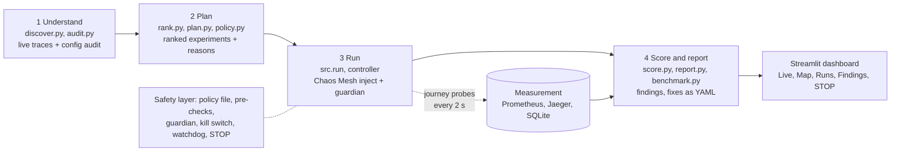

# ChaosPilot: architecture overview (one page)

**AI proposes, policy decides, code executes and scores.** ChaosPilot reads a live Kubernetes app (the OpenTelemetry Demo), finds where it is fragile, chooses which failures to test first, injects them safely, measures what users would feel, scores the result and writes the fix as ready-to-apply YAML. The detailed spec is in [Architecture.md](Architecture.md).

## Components

| Stage | What it does | Code |
|---|---|---|
| 1. Understand | Maps services and calls from live traces (18 services, 23 edges). Audits configuration (single replica, no probes, no PodDisruptionBudget) and predicts a weakness per service. | `src/discover.py`, `src/audit.py` |
| 2. Plan | Ranks services by dependency position and traffic. The top 8 become experiments, each with a hypothesis and a reason. An LLM may reword the text only; it cannot change a target or fault. `policy.py` approves or rejects each experiment. | `src/rank.py`, `src/plan.py`, `src/policy.py` |
| 3. Run | `src.run` is the only way to inject. Chaos Mesh applies pod kill, network delay or CPU stress. Probes track the browse, cart and checkout journeys every 2 s while the guardian watches the thresholds. | `src/run.py`, `src/chaos/controller.py`, `src/chaos/guardian.py`, `src/probe.py`, `src/observe.py` |
| 4. Score and report | Code computes `S = 100 x (0.45 A + 0.20 L + 0.20 R + 0.15 C)` per run (A success, L latency, R recovery, C containment), then a criticality-weighted overall score with coverage. The report ranks findings by severity with trace evidence and links a fix patch to each. A benchmark compares our ranked order with random order. | `src/score.py`, `src/report.py`, `src/benchmark.py`, `src/fixes.py` |

## How the AI makes decisions

- **What the AI does:** an LLM (optional) rewrites the hypothesis and reason of each planned experiment. Its output is schema-checked; on any failure a template is used.
- **What the AI never does:** choose targets, inject faults, touch the cluster, or compute a score. Ranking, policy, injection, the guardian, measurement, scoring and fix patches are deterministic code, so the same data gives the same plan and scores.
- **Fixes** are delivered as Kubernetes patches in `reports/fixes/` and are never applied automatically. A human applies them.

## Safety controls (on every run)

1. **Policy file** (`config/policy.yaml`): allowed faults, caps and forbidden targets (for example the probe path, `frontend-proxy`). Checked at planning and again at run time.
2. **Pre-checks:** `kubectl auth can-i delete`, server-side dry-run of the manifest, and a shop health gate (the shop must meet its SLOs before anything is injected; it re-checks twice before refusing).
3. **Guardian:** stops the fault when error rate, latency or probe success cross their thresholds.
4. **Kill switch and detached watchdog:** the fault is removed even if the run process crashes.
5. **STOP button / `python -m src.run --stop-all`:** deletes every chaos object and blocks new runs; no LLM involved. Ctrl+C also triggers a confirmed cleanup (both tested live on 11 Oct).
6. **Hard caps:** faults last at most 60 s, one at a time, in the team's own sandbox cluster only.

## Stack

OpenTelemetry Demo (Helm chart 0.42.3) on Kubernetes, Chaos Mesh, Prometheus, Jaeger, Python, SQLite, Streamlit.
