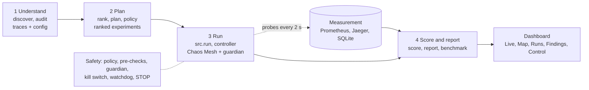

# ChaosPilot: AI-driven chaos engineering for cloud-native resilience

ChaosPilot reads a live Kubernetes app, finds where it is fragile, decides which failures to test first, injects them
safely, measures what users would feel, scores the result, and hands back a ready-to-apply fix for each weakness.
Built for the Bosch hackathon (MIT Bengaluru, 10-11 Oct 2026) on the
[OpenTelemetry Demo](https://opentelemetry.io/docs/demo/), an open-source online shop made of about 20 services.

**Safe by design: AI proposes, policy decides, code executes and scores.**
An LLM is optional and only writes the hypothesis text of a planned experiment. It never picks targets, never touches
the cluster and never computes a number. Targets, fault types, parameters, safety limits, measurements, scores and
the findings report all come from deterministic code.

## Contents

1. [Results](#results) · 2. [How it works](#how-it-works) · 3. [Where the AI is used](#where-the-ai-is-used) ·
4. [Dashboard](#dashboard) · 5. [Safety layers](#safety-layers) · 6. [Setup](#setup-windows-docker-desktop-kubernetes) ·
7. [Running experiments](#running-experiments) · 8. [Scoring](#scoring) · 9. [Fixes](#fixes-recommendations) ·
10. [Tests](#tests) · 11. [Repo map](#repo-map) · 12. [Troubleshooting](#troubleshooting) · 13. [Known limits](#known-limits) ·
14. [Hackathon deliverables](#hackathon-deliverables)

## Results

Live runs on a single-node Docker Desktop cluster, 11 Oct 2026 (10 real runs, 3 fault types, 7 of 8 approved
experiments run). The authoritative, regenerated numbers are in `reports/findings_report.md`
(`python -m src.report`).

| Experiment | Fault | Target | Outcome | S | Severity |
|---|---|---|---|---|---|
| exp-004 | pod kill | cart | degraded, recovered in about 14 s (2 runs) | 32.7 | **High** |
| exp-003 | 200 ms network delay | astronomy-db | degraded, recovered (2 runs) | 82.0 | **Medium** |
| exp-002 | CPU stress | product-catalog | survived | 100 | Low |
| exp-005 | CPU stress | currency | survived | 100 | Low |
| exp-006 | 200 ms network delay | shipping | survived (2 runs) | 100 | Low |
| exp-008 | CPU stress | payment | survived | 100 | Low |
| exp-007 | pod kill | frontend | stopped early by the guardian: too few samples, **not scored** | n/a | inconclusive |
| exp-001 | pod kill | frontend-proxy | refused by design (it carries the measurement path) | n/a | not run |

Overall resilience score **86.5 / 100**, shown with coverage: 6 of 8 approved experiments scored.
Honest notes: no Critical finding; the ranked order beat random order only slightly (8 experiments is a small
sample); the CPU-stress runs show "no user-visible impact" because there is no CPU metric, so they do not prove the
services are CPU-resilient.

## How it works



| Step | Command | Output |
|---|---|---|
| Map services and calls from live traces | `python -m src.discover` (offline: `--fixtures`) | `data/graph.json` |
| Audit configuration, predict weaknesses | `python -m src.audit` | `data/risks.json` |
| Rank what to test first | `python -m src.rank` | `data/ranked_candidates.json` |
| Plan experiments | `python -m src.plan` (`--deterministic` = no LLM) | `data/plan.json` |
| Policy check (drop anything out of scope) | `python -m src.policy` | `data/plan_validated.json` |
| Fix-as-code suggestions | `python -m src.fixes` | `reports/fixes/` |
| Run one approved experiment | `python -m src.run --exp exp-004 --execute` | `data/runs/<exp>-r<n>.json`, `data/runs.db` |
| Run every approved experiment in sequence, then score and report | `python -m src.run_all` (`--list`, `--skip`, `--exp-ids`) | `data/runs/`, `data/batch_status.json`, `reports/findings_report.md` |
| Score the runs | `python -m src.score` | `data/scores.json` |
| Findings report and benchmark | `python -m src.report` | `reports/findings_report.md` |
| Dashboard | `streamlit run dashboard/app.py` | live view, map, runs, findings, control |

1. **Understand.** Builds a dependency map from live Jaeger traces (18 services, 23 edges) and audits each service's
   configuration (single replica, no probes, no PodDisruptionBudget, no autoscaler). Each weakness becomes a prediction.
2. **Plan.** Ranks services by how much of the shop depends on them (fan-in, share of traffic, checkout path). The top 8
   become experiments with a fault type, parameters, a hypothesis, a reason and the journeys expected to be hurt.
   `policy.py` approves or rejects each one against `config/policy.yaml`.
3. **Run.** `src/run.py` is the only way to inject. It re-checks policy, refuses unsafe targets, checks the shop is
   healthy, then `src/chaos/controller.py` injects through Chaos Mesh and a guardian watches the shop until the fault
   is removed and the shop has recovered. Journey probes (browse, cart, checkout) run every 2 s throughout.
4. **Score and report.** Code computes how much users suffered and how fast the shop recovered, ranks the findings by
   severity with trace evidence, and links the matching fix patch to each one.

Faults available (Chaos Mesh): `pod_kill` (PodChaos), `network_delay` and `packet_loss` (NetworkChaos), `cpu_stress`
(StressChaos). Every timed fault lasts at most 60 s; policy caps any fault at 120 s.

## Where the AI is used

| Part | Uses an LLM? | What it does |
|---|---|---|
| Planner text (`src/plan.py`) | Optional | Rewrites each experiment's hypothesis, reason and expected journeys. Output is schema-checked and length-checked; on any failure the deterministic template text is kept. Provider is set in `config/planner.yaml`: `groq` (`GROQ_API_KEY`, `pip install groq`) or `anthropic` (`ANTHROPIC_API_KEY`). `data/plan_validated.json` records `planner` (`llm` or `deterministic`) and the model per experiment. |
| Targets, fault types, parameters | No | Ranking formula and fault catalog (`src/rank.py`, `config/fault_catalog.yaml`) |
| Policy, guardian, kill switch, STOP | No | Fixed rules and thresholds |
| Measurement, scores, severity, report | No | `src/runmetrics.py`, `src/score.py`, `src/report.py` |
| Fix patches | No | Templates in `config/fixes.yaml` filled from the findings (`src/fixes.py`) |

The LLM can never change a target, a fault or a parameter: those fields are copied only from the deterministic plan.
`agents/recovery_agent/` is a standalone LLM agent kept for reference; it is not part of the run path and produced no
scores.

## Dashboard

```powershell
streamlit run dashboard/app.py
```

Start it from a window that has the environment variables from [Running experiments](#running-experiments); the
experiment it launches inherits them.

| Tab | What it shows |
|---|---|
| Live | Success rate and latency per journey, with experiment windows shaded |
| Map | The service dependency graph from Jaeger traces, and the predicted risks |
| Runs | Overall score, coverage, per-experiment and per-run scores, raw samples |
| Findings | The generated findings report |
| Control | The plan; start an experiment; automatic stop and recall; fixes (view, dry-run, apply, roll back) |

The **Control** tab does the same things as the command line, with the same safety checks:

- **Start experiment** runs `python -m src.run --exp <id> --execute` and types the confirmation word for you once you
  have typed `reslab-experiment`. Only one run at a time. A checklist shows policy, STOP file, running state and the
  age of the guard baseline.
- **Automatic stop** shows the guardian's real limits from config and whether it is armed or has stopped the run.
- **Run batch** (Control tab) runs `python -m src.run_all` for the experiments you pick: fresh baseline, guardian and kill switch for each, a pause between them, and scoring plus the report at the end. It stops at the first failed run or when the STOP file appears.
- **Recall** runs `python -m src.run --stop-all`; **Re-arm** deletes the STOP file afterwards.
- **Fixes** shows each patch, a server-side dry run, **Apply** and **Roll back** (both need `apply-fix` typed).
  Apply saves how to undo the change first. Every action is logged in `data/dashboard_actions.log`.

The sidebar **STOP ALL FAULTS** button is always available and needs no LLM.

## Safety layers

| Layer | What | Needs the LLM |
|---|---|---|
| L0 policy | Only the `otel-demo` namespace; forbidden targets; caps on duration, latency and loss (`config/policy.yaml`); re-checked in `src/run.py` | No |
| Pre-checks | `kubectl auth can-i delete`, server-side dry run of the manifest, a fresh guard baseline, and a shop health gate (20 s of probes, re-checked up to 2 more times before refusing) | No |
| Refusals | Never faults the service that carries the measurement path (`frontend-proxy`); refuses when nothing can be measured; refuses while a STOP file exists or another sampler is writing | No |
| L1 guardian | Aborts after 3 consecutive breaches (error ratio above 0.05, or p95 above 3x baseline and at least 1500 ms) or at the time limit, then verifies the fault object is gone (`config/chaos_settings.json`) | No |
| L2 kill switch and watchdog | Every timed fault has a duration; a detached watchdog deletes our fault object at the deadline even if the controller dies; Ctrl+C triggers a confirmed cleanup | No |
| L3 STOP | `python -m src.run --stop-all` (or the dashboard buttons) blocks new runs and deletes every chaos object in the namespace | No |

One experiment at a time. Nothing is injected until you type the confirmation word. STOP and Ctrl+C were tested live
on 11 Oct (fault removed, cleanup confirmed).

## Setup (Windows, Docker Desktop Kubernetes)

Needs about 8 GB for the cluster. Python 3.11+. Run from the repo root in PowerShell.

```powershell
python -m venv .venv
.venv\Scripts\Activate.ps1
pip install -r requirements.txt
```

1. Turn on Kubernetes in Docker Desktop, then `kubectl config use-context docker-desktop`, and install Helm
   (`winget install Helm.Helm`).
2. Install the OpenTelemetry Demo from the pinned values file. Do not use `--reuse-values` or `--set` afterwards (D-034):
   ```powershell
   helm repo add open-telemetry https://open-telemetry.github.io/opentelemetry-helm-charts
   helm repo update
   helm install otel-demo open-telemetry/opentelemetry-demo -n otel-demo --create-namespace --version 0.42.3 -f config/otel-demo-values.yaml
   ```
   The values file turns off OpenSearch, host metrics and the optional services, and sends collector logs to `debug`
   only. With the chart default, failing log exports blocked the quote service and broke checkout.
3. Install Chaos Mesh (Docker runtime). Chart version: see `ChaosMonkeys/techstack.md`.
   ```powershell
   helm repo add chaos-mesh https://charts.chaos-mesh.org
   helm install chaos-mesh chaos-mesh/chaos-mesh -n chaos-mesh --create-namespace --set chaosDaemon.runtime=docker --set chaosDaemon.socketPath=/var/run/docker.sock --set controllerManager.replicaCount=1 --set dashboard.create=false
   ```
4. Wait until `kubectl -n otel-demo get pods` shows everything `Running`.

Optional planner text from an LLM: `pip install groq`, set `$env:GROQ_API_KEY` in your window (never in a file), and run
`python -m src.plan` then `python -m src.policy`. Without a key the planner keeps the deterministic text.

Full setup notes, Docker Desktop fixes and the reasons behind them: `ChaosMonkeys/Requirementsandsetup.md`.

## Running experiments

Keep three PowerShell windows open for the port-forwards (8081 because 8080 is taken on some laptops):

```powershell
kubectl -n otel-demo port-forward svc/frontend-proxy 8081:8080
kubectl -n otel-demo port-forward svc/prometheus 9090:9090
kubectl -n otel-demo port-forward svc/jaeger 16686:16686
```

Jaeger is read directly on 16686, not through frontend-proxy: heavy trace queries through the proxy made the in-memory
Jaeger run out of memory and restart, which wipes every stored trace.

In the repo root, with the venv active (set the same variables in the dashboard's window):

```powershell
$env:PROBE_BASE_URL="http://localhost:8081"
$env:PROMETHEUS_URL="http://127.0.0.1:9090"
$env:JAEGER_URL="http://localhost:16686/jaeger/ui/api/v3"

python -m src.baseline --seconds 300                  # 5-minute steady-state baseline (no other sampler running)
python -m src.run --list                              # which approved experiments are runnable, and why not
python -m src.chaos.k8s_monitor --baseline 60         # guard baseline (must be under 30 min old)
python -m src.run --exp exp-004 --preview             # server-side dry run, nothing created
python -m src.run --exp exp-004 --execute             # real fault; asks for the confirmation word
python -m src.score
python -m src.report
```

Or do the same from the dashboard's **Control** tab. Do not run a second sampler (`python -m src.observe`) during a
run: the controller starts its own and refuses if it sees another. Wait about 15 s between runs.

## Scoring

`S = 100 x (0.45 A + 0.20 L + 0.20 R + 0.15 C)` per run (D-008), averaged over repeats, then weighted by service
criticality into the overall score, always shown with coverage.

- **A** successful requests during the fault window; **L** requests that were successful and fast enough (journeys
  weighted checkout 0.4, cart 0.3, browse 0.2, ads-recs 0.1).
- **R** 1 if the shop survived; otherwise 1 minus recovery time over the recovery budget; 0 if it did not recover.
- **C** containment: the share of journeys not targeted that stayed within SLO. When every probed journey is a target
  it is shown as n/a and the other three weights are rescaled (not scored as 1.00).
- A journey needs at least 3 samples in the fault window; with none left the run is **inconclusive** and gets no score.
- A breach that appears long after the fault ended is listed as a blip and not scored.
- Severity = (100 - S) x service criticality: Critical at 30 or more, High at 15, Medium at 5, otherwise Low.
- `src/benchmark.py` compares the planner's ranked order with random orders (exact for 8 or fewer experiments).

## Fixes (recommendations)

`python -m src.fixes` turns each predicted weakness into a Kubernetes patch under `reports/fixes/` (60 findings, 66
patches that pass `kubectl --dry-run=server`, 9 marked manual because no safe generic patch exists, for example a
stateful single replica). `reports/fixes/index.json` lists each patch and its apply command, and the report links the
matching fix to each finding. Fixes are **never applied automatically** (D-007). Apply one from the dashboard's Control
tab (dry run, type `apply-fix`, apply, roll back) or with the command in `index.json`. Applying a fix changes the
system that was measured, so earlier scores describe the old system.

## Tests

```powershell
python -m unittest discover tests
```

126 tests, offline: no cluster or network needed. Test data is synthetic and never reported as a result.
`tools/dry_run.py` and `tools/fake_shop.py` are for development only.

## Repo map

| Path | What |
|---|---|
| `src/` | pipeline (discover, audit, rank, plan, policy, fixes), run path (`run.py`, `chaos/`), measurement (`probe.py`, `observe.py`, `runmetrics.py`, `evidence.py`), scoring (`score.py`, `report.py`, `benchmark.py`) |
| `src/chaos/` | controller, guardian, kill switch, Chaos Mesh executor, guard baseline monitor |
| `config/` | policy, criticality, journeys and SLOs, chaos settings, planner, fault catalog, fix templates, executor, cluster Helm values |
| `agents/chaos_agent_expanded/` | the detached watchdog (used); `agents/recovery_agent/` kept for reference only |
| `dashboard/` | Streamlit dashboard (`app.py`) and the Control tab (`control.py`) |
| `reports/fixes/` | suggested Kubernetes patches and `index.json` (never applied automatically) |
| `reports/findings_report.md` | the generated findings report |
| `ChaosMonkeys/` | Architecture (`Architecture_Overview.md` is the one-pager), Decisions, Rules, setup notes, demo script, progress log |
| `data/` | local runs, samples and generated files (git-ignored; the planner's pipeline outputs are tracked as evidence) |

## Troubleshooting

| Symptom | Cause and fix |
|---|---|
| "Shop not healthy before injection" | The gate refused, which is safe. Wait 20 s and retry. If every journey shows 0.00, the shop port-forward is down or another program holds the port (a `401` from `localhost:8080` means that): forward on 8081 and set `PROBE_BASE_URL`. |
| "Another sampler is writing" | Two runs started within 15 s, or `python -m src.observe` is running. Wait, or stop it. |
| Guard baseline too old or missing | `python -m src.chaos.k8s_monitor --baseline 60` (must be under 30 min old). |
| "STOP file present" | Someone pressed STOP. After checking the shop, delete `data\STOP` or use **Re-arm** on the Control tab. |
| Dashboard shows "No valid baseline yet" | `python -m src.baseline --seconds 300` with no other sampler running. |
| Run file says Jaeger unreachable | Start the Jaeger port-forward and set `JAEGER_URL` as shown above. |
| Pods stuck Pending after a Helm change | Memory: never use `--reuse-values`; see D-034 and `config/otel-demo-values.yaml`. |
| Downloaded file copied, but old behaviour | The browser saved it as `name (1).py`; copy the newest file. |

## Known limits

- Results come from one single-node Docker Desktop cluster and a small number of runs; repeats are shown where they exist.
- The shop shows a low background error rate (a lone fast 503 every few minutes) even with no fault; the source is not
  found yet. The shop gate re-checks before refusing, and the scorer does not count a blip that appears after a fault ended.
- A pod kill is instant, so its fault window holds few samples; the guardian can also stop a run early, which leaves it unscored.
- `frontend-proxy` cannot be tested on this setup because it carries the measurement port-forward.
- There is no CPU metric, so CPU-stress results say "no user-visible impact", not "CPU-resilient".
- The planner benchmark uses the experiments scored so far (small sample).
- Not built: combined failures, automatic fix-and-re-run, a scheduler that runs experiments unattended. Starting a fault
  and applying a fix are deliberately manual, behind typed confirmation words.

## Hackathon deliverables

| Deliverable | Where |
|---|---|
| Source code and README | this repository |
| Demo video (3 minutes or less) | script in `ChaosMonkeys/Demo.md` |
| Architecture overview (one page) | `ChaosMonkeys/Architecture_Overview.md` (detail: `ChaosMonkeys/Architecture.md`) |
| Findings report | `reports/findings_report.md` |
| Team form | submitted separately |

Rules and decisions: `ChaosMonkeys/Rules.md`, `ChaosMonkeys/Decisions.md`.
