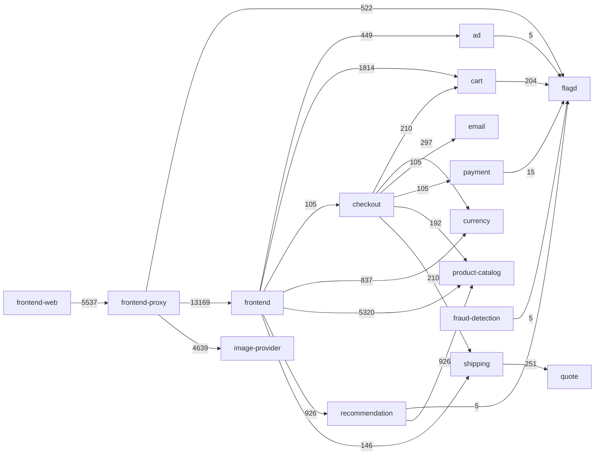

# Application map

Generated 2026-10-10T09:52:26.154833+00:00 (namespace otel-demo, Jaeger lookback 1h).

| Service | Kind | Ready | Upstream | Downstream |
|---|---|---|---|---|
| accounting | deployment | 1/1 | - | - |
| ad | deployment | 1/1 | frontend | flagd |
| astronomy-db | deployment | 1/1 | - | - |
| cart | deployment | 1/1 | checkout, frontend | flagd |
| checkout | deployment | 1/1 | frontend | cart, currency, email, payment, product-catalog, shipping |
| currency | deployment | 1/1 | checkout, frontend | - |
| email | deployment | 1/1 | checkout | - |
| flagd | deployment | 1/1 | ad, cart, fraud-detection, frontend-proxy, payment, recommendation | - |
| fraud-detection | deployment | 1/1 | - | flagd |
| frontend | deployment | 1/1 | frontend-proxy | ad, cart, checkout, currency, product-catalog, recommendation, shipping |
| frontend-proxy | deployment | 1/1 | frontend-web | flagd, frontend, image-provider |
| frontend-web | trace-only | - | - | frontend-proxy |
| grafana | deployment | 1/1 | - | - |
| image-provider | deployment | 1/1 | frontend-proxy | - |
| jaeger | deployment | 1/1 | - | - |
| kafka | deployment | 1/1 | - | - |
| load-generator | deployment | 1/1 | - | - |
| opamp-server | deployment | 1/1 | - | - |
| opensearch | statefulset | 1/1 | - | - |
| opensearch-headless | service_only | - | - | - |
| otel-collector | service_only | - | - | - |
| payment | deployment | 1/1 | checkout | flagd |
| product-catalog | deployment | 1/1 | checkout, frontend, recommendation | - |
| prometheus | deployment | 1/1 | - | - |
| quote | deployment | 1/1 | shipping | - |
| recommendation | deployment | 1/1 | frontend | flagd, product-catalog |
| shipping | deployment | 1/1 | checkout, frontend | quote |
| telemetry-docs | deployment | 1/1 | - | - |
| valkey-cart | deployment | 1/1 | - | - |
